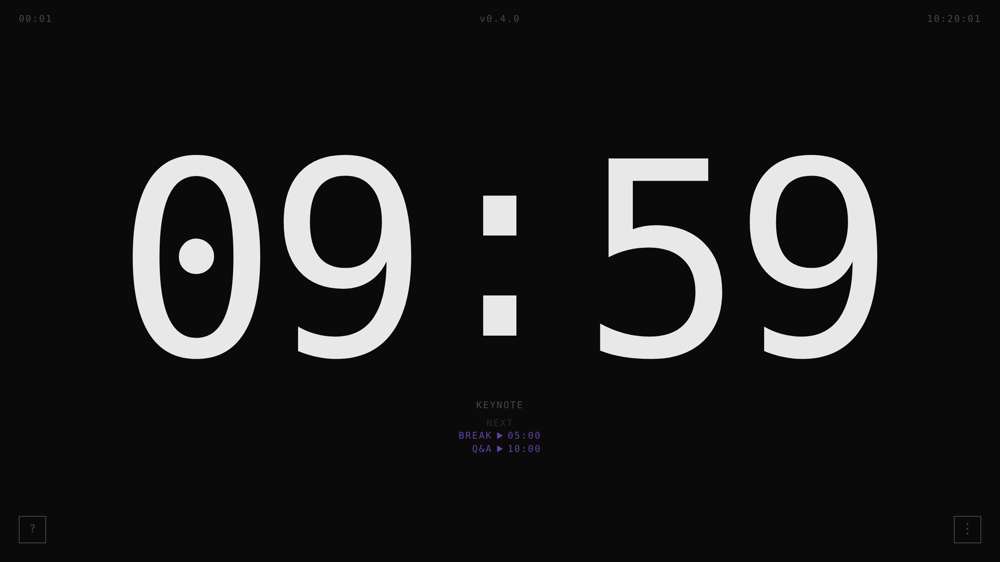
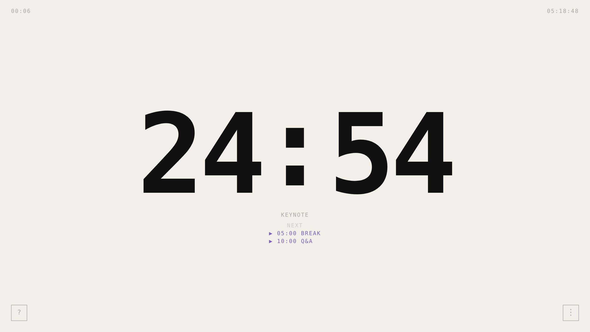

# /tick

**/tick** is a countdown timer that runs in a web browser. People use it to keep time during talks, live streams, meetings and stage events. The whole program is one file, `tick.html`. It does not need to be installed, and it works without an internet connection.

- Live version: [acari.vercel.app](https://acari.vercel.app)
- Source code: [github.com/Arty2/tick](https://github.com/Arty2/tick)
- Website: [heracl.es/tick](https://heracl.es/tick)



---

## Starting

There are two ways to use /tick:

- Open [acari.vercel.app](https://acari.vercel.app) in a browser.
- Download `tick.html` and open it. This copy works with no internet connection.

The file can also be put on any web server. It needs no other files.

---

## Features

- Counts down from any length between 1 and 999 minutes.
- After the time runs out, the numbers turn red and count up. This is called **overtime**.
- Keeps a **queue**: a list of sessions, each with a name and a length. When one session ends, the next one starts by itself.
- Can count down to a time of day, such as 14:30.
- Has a **clock mode** that shows the time of day while the timer keeps running.
- Can be controlled from a phone or another computer (**remote control**).
- Changes colour at two warning points before the end. For sessions longer than 10 minutes, the first warning comes 5 minutes before the end.
- Can ring a bell. The bell sound is made by the program, not played from a recording.
- Has five **presets**: saved lengths that load with one click.
- Has a **kiosk mode** that hides everything except the time.
- Can make a link that opens the same timer on another device.
- Has a dark theme and a light theme.



---

## Screen layout

```
┌─────────────────────────────────────────────────────┐
│  00:00 (since start)   v0.3.3   HH:MM:SS (clock)    │
│                                                     │
│              STATUS                                 │
│              25:00                                  │
│              Session name                           │
│              NEXT                                   │
│              ▶ 10:00  Talk                          │
│                                                     │
│  [?]                                          [⋮]   │
└─────────────────────────────────────────────────────┘
```

- The top left shows how long the timer has been running since it was first started.
- The top middle shows the version number. It is hidden in kiosk mode.
- The top right shows the time of day.
- The **?** button (bottom left) opens the manual.
- The **⋮** button (bottom right) opens the menu.

---

## Controls

### Mouse and touch

| Action | What it does |
|---|---|
| Click or tap | Starts the timer. Another click pauses it, and another starts it again. |
| Click or tap in overtime | Loads the next session in the queue. If the queue is empty, it resets the timer. |
| Tap the queue under the timer | Opens the queue. |
| Double-click or double-tap | Turns kiosk mode on or off. |
| Mouse wheel (while running) | Adds or takes away 1 minute. |
| Swipe up, down, left, right (while running) | Adds 10, takes away 5, adds 1, or takes away 1 minute. |

### Keyboard

| Key | What it does |
|---|---|
| `Enter` | Starts again from the starting length. |
| `Space` | Starts or pauses. In overtime, loads the next session, or starts again. |
| `0`–`9`, then `Enter` | Sets the length in minutes. For example, `2`, `5`, `Enter` sets 25 minutes. |
| `Ctrl+Enter` | Loads the next session in the queue now. It waits until it is started. |
| `↑` `↓` `←` `→` | Adds 10, takes away 5, adds 1, or takes away 1 minute. |
| `Ctrl+↑`, `Ctrl+↓` | Loads the previous or next preset. |
| `N` | Opens the queue. |
| `U` | Opens the target time (counting down to a time of day). |
| `W` | Opens the warning settings. |
| `Delete` or `Backspace` | Changes the session name. `Enter` saves it. |
| `` ` `` | Rings the bell. |
| `Insert` | Changes the sound setting. |
| `Page Up` | Turns kiosk mode on or off. |
| `Page Down` | Changes between the dark and light themes. |
| `End` | Resets the timer. |
| `Home` | Opens or closes the manual. |
| `Tab` | Opens the menu. |
| `Escape` | Closes the menu or a window. If none is open, it leaves target time, clock mode or kiosk mode. |

The keys only change the timer when no text box is being typed in.

---

## Queue

The queue is a list of sessions that run one after another. To open it, press `N`, choose **▶ queue** in the menu, or click the list under the timer.

- **Current session** is the name shown under the timer.
- **Up next** is the list of sessions. Each one has a name and a length in minutes, or a time of day written `@14:30`, which makes that session count down to 14:30. **+ Add** adds a session, **×** removes one, and dragging a row changes the order.
- When a session ends, the next one loads and starts by itself. A short sound plays.
- The queue and the session name are saved in the browser. They are still there the next time /tick is opened.

### Writing a queue

A queue can also be written as text: in a link, or in the queue box on the remote pad. Sessions are separated by `|` (a vertical bar), and each session is one of these:

| Written | Means |
|---|---|
| `Talk:25` | A session called Talk, 25 minutes long |
| `25` | A 25-minute session with no name |
| `Panel@14:30` | A session called Panel that counts down to 14:30 (the next 14:30, which may be tomorrow) |
| `@14:30` | A countdown to 14:30 with no name |

For example, `Keynote:40|Break:5|Q&A, panel:15|Lunch@12:30`. Names may contain commas and colons. A `|` inside a name is written `\|`.

---

## Target time

The **target** button (or `U`) makes the timer count down to a time of day. The time is written in the 24-hour clock, such as 14:30. The box first shows the next full or half hour. If the time has already passed today, the timer counts down to that time tomorrow.

---

## Presets

The menu has five preset buttons. Clicking one loads its length. Holding a preset down, or right-clicking it, opens a box to change its name and length. An empty preset shows **+**. At first, the presets are 5, 10 and 25 minutes.

Holding down the **reset** button for about one second removes everything /tick has saved: presets, queue, settings and the session name.

---

## Warnings

The timer changes colour before the end, at two points:

- At the **first warning** the numbers turn orange. This is 2 minutes before the end. For a session longer than 10 minutes, it is 5 minutes before the end.
- At the **second warning** the numbers also flash. This is 1 minute before the end at first.

The **warn** button (or `W`) changes these points. They are set in seconds. Setting one to `0` turns it off. If the first warning's box is left empty, it goes back to 2 or 5 minutes, as above.

---

## Remote control

The remote control lets another device start, pause and change the timer.

1. Choose **remote** in the menu. A code of six letters and numbers appears, with a QR code.
2. On the other device, scan the QR code or open the link. Without a camera, open /tick on that device, choose **remote**, then **Control another timer instead**, type the code and choose **Join**.
3. The other device now shows a **remote pad**, and the timer screen changes to kiosk mode. It stays in kiosk mode if the remote pad disconnects.

The remote pad's top bar shows the connection, the timer's code and a small screen button (🖥️). Typing another code into the bar and pressing Enter switches the pad to that timer. Under the top bar, the remote pad shows the same line as the timer screen: the time since the session started on the left, and the time of day on the right. Below that it shows the time left, the session name and the queue. Its buttons reset, start or pause (one button, which changes between the two), ring the bell, load the next or the previous session, and add or take away time. **Prev** goes back to the session that ran before and puts the current one back at the front of the queue; it is greyed out until a session has handed over to the next. **Black** covers the whole timer screen in the theme's background colour (black in the dark theme, white in the light one). The timer keeps running underneath, and changes made from the remote pad don't show until **Black** is pressed again. The button is lit while the screen is covered. On the timer screen itself, `Escape`, a double tap or a double-click also lifts the cover, so it can be lifted without the remote or a keyboard; single taps and clicks on the cover do nothing. Its queue box shows the current queue, written as described in [Writing a queue](#writing-a-queue), such as `Talk:25|QA@14:30`. Changing it and pressing **Set** changes the queue; emptying it and pressing **Set** clears the queue. On phones, the buttons vibrate when pressed.

The remote pad has a message box. A message typed there appears on the timer screen for 6 seconds, in large dark letters on an orange band above the time. The time gets smaller while the message shows, so both can be read. It can tell the speaker, for example, to finish soon. **Clear** removes it sooner.

If the timer screen stops answering for a few seconds, the remote pad says **Kiosk lost**. The small screen button (🖥️) next to the connection status shows a link and a QR code. Opening it on any screen starts a new timer screen with the same code. The new screen continues the timer from where the old one stopped.

The timer does not stop when the kiosk is lost. The remote pad keeps counting on its own, and its buttons (start, pause, the minute buttons, reset, Next and the queue box) work on the pad's copy; the time is underlined with dots while this is so. When the kiosk answers again, the pad's timer is sent to it and replaces the kiosk's, because the pad kept going while the kiosk was out of touch. There is one exception: if the remote pad itself went offline, it says **Offline**, and when it is back it takes the kiosk's timer instead.

Two tabs in the same browser connect straight away, without the internet. Two different devices need the internet. They are connected through a free service called [PeerJS](https://peerjs.com). This may not work on some school or office networks.

---

## Links that set up the timer

A link to /tick can include settings after a `?`. These settings are used for that visit only. They do not replace the settings saved in the browser.

| Setting | Values | What it does |
|---|---|---|
| `mins` | `1`–`999` | The starting length in minutes. |
| `label` | text | The session name. |
| `next` | `Break:5\|QA@14:30` | The queue, written as described in [Writing a queue](#writing-a-queue): sessions separated by `\|`, each `name:minutes`, minutes alone, or `name@HH:MM`. |
| `theme` | `dark` or `light` | The theme. |
| `sound` | `0`, `1` or `2` | The sound setting: off, bell at the end, or a bell every minute of overtime. |
| `rc` | a six-letter code | Opens the remote pad for that code. The **remote** button makes these links. |
| `host` | a six-letter code | Opens a new timer screen for that code, which continues the timer. The small screen button (🖥️) on the remote pad makes these links. |

For example, this link opens a 25-minute keynote with a break and questions after it:

```
https://acari.vercel.app/?mins=25&label=Keynote&next=Break:5|QA:10&theme=dark&sound=1
```

The **share** button copies a link like this for the timer as it is now.

---

## Kiosk mode

Kiosk mode hides the buttons and the menu, so that only the time and the top line are shown. It is turned on with a double-click, a double-tap, `Page Up`, or the **kiosk** button. It is turned off the same way, or with `Escape`.

On computers, kiosk mode also fills the whole screen and stops the screen from going dark. On iPhones and iPads the browser's address bar stays, because Safari does not allow web pages to fill the screen.

---

## Sound

The **sound** button (or `Insert`) changes between three settings:

- **Off**: no bell.
- **End**: one bell when the time runs out.
- **Min**: a bell when the time runs out, and another at each minute of overtime.

`` ` `` rings the bell at any time, and so does holding down the **sound** button.

---

## Colours

| Colour | Meaning |
|---|---|
| Grey | Not started |
| White | Running |
| Orange | Close to the end (flashing near the very end) |
| Amber | Paused |
| Red | Overtime |
| Green | Just reset |
| Purple | The next session is loaded |
| Blue | Counting down to a time of day |
| Teal | Clock mode |

---

## Working offline

A downloaded copy of `tick.html` works with no internet connection. The live version needs the internet to load, like any web page. On a phone, the page can be added to the home screen, where it opens without the browser's address bar.

---

## External services: what leaves this computer

The timer uses no outside services. Nothing is sent anywhere until the remote control is opened; the timer, queue, presets and settings are kept only in this browser.

Choosing **remote**, or the small screen button on the remote pad, uses these external services, and no others:

| Service | Run by | What it does | What it receives | Without it |
|---|---|---|---|---|
| `api.qrserver.com` | [goQR.me](https://goqr.me/api/), a free QR code API | Draws the QR codes | The remote or kiosk link, including its code | The link is shown as text instead |
| `cdn.jsdelivr.net` | [jsDelivr](https://www.jsdelivr.com), a free public CDN | Sends the PeerJS program (version 1.5.4) used to connect two devices. /tick checks a fixed fingerprint and refuses a changed file | An ordinary download request | Only tabs in the same browser can connect |
| `0.peerjs.com` | [PeerJS](https://peerjs.com), its free public server | Introduces the two devices to each other | An ID made from the code | Only tabs in the same browser can connect |
| `stun.l.google.com`, `stun1.l.google.com` | Google, public STUN servers | Help the two devices find a direct route through routers | The devices' network addresses | Devices on different networks may not connect |

After the introduction, the two devices talk to each other directly (WebRTC); the timer itself never passes through these services. Two tabs in the same browser use none of them.

The live version is hosted by [Vercel](https://vercel.com), which serves the page when it is opened. A downloaded copy of `tick.html` needs no host at all.

---

## Limitations

- **iPhone and iPad**: kiosk mode cannot fill the whole screen.
- **Remote control between devices**: needs the internet, and needs peerjs.com to be reachable.
- **QR code**: needs the internet. Without it, the link is shown as text.

---

## Development

/tick needs nothing except `tick.html`. The tests need [Node.js](https://nodejs.org) and pnpm:

```
pnpm install
pnpm test          # checks the rules, then runs the browser tests
pnpm run serve     # serves the app at http://localhost:4173
```

| Version change | When |
|---|---|
| Patch (`0.3.3` → `0.3.4`) | A fix |
| Minor (`0.3.3` → `0.4.0`) | A new feature |
| The first number | Changes only when the project is decided to be finished |

The version number is written in one place: `<meta name="version">` in `tick.html`. The manual shows it, and [CHANGELOG.md](./CHANGELOG.md) starts with it. [AGENTS.md](./AGENTS.md) explains how to work on the project.

| File | What it is |
|---|---|
| `tick.html` | The whole program |
| `README.md` | This file |
| `CHANGELOG.md` | What each version added |
| `AGENTS.md` | How to work on the project, for people and AI agents |
| `tests/` | Browser tests (Playwright) |
| `scripts/` | The rule checks, a test server, and a feedback helper |
| `vercel.json` | How the live version is built and protected |

---

## Deployment

The live version at [acari.vercel.app](https://acari.vercel.app) is built by Vercel, using `vercel.json`. Only `tick.html` is published; the tests and documents are not. Visiting the main address opens `/tick.html`, and any settings in the link are kept, so `https://acari.vercel.app/?mins=25` opens a 25-minute timer. Every page is sent with the security headers in `vercel.json`. One of them, the Content-Security-Policy, lets the page reach only the services listed in [External services](#external-services-what-leaves-this-computer).

---

## Credit and licence

Dialectic Acheiropoieton of Heracles Papatheodorou and Claude.

The MIT licence applies. See [LICENSE](./LICENSE).
